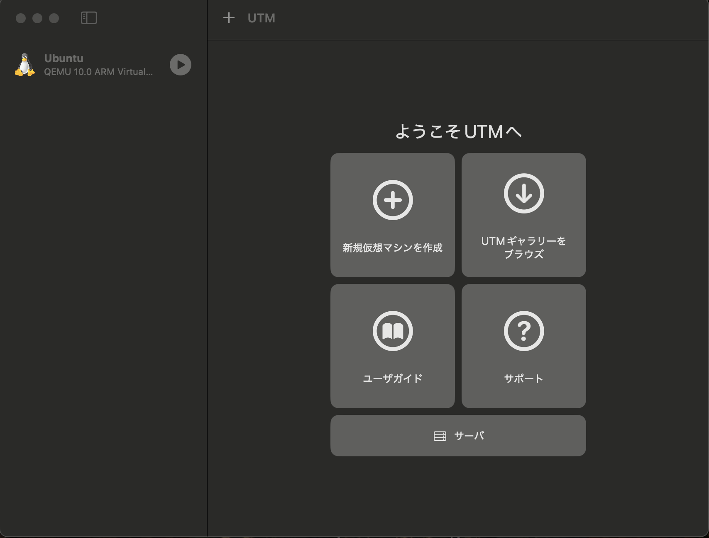
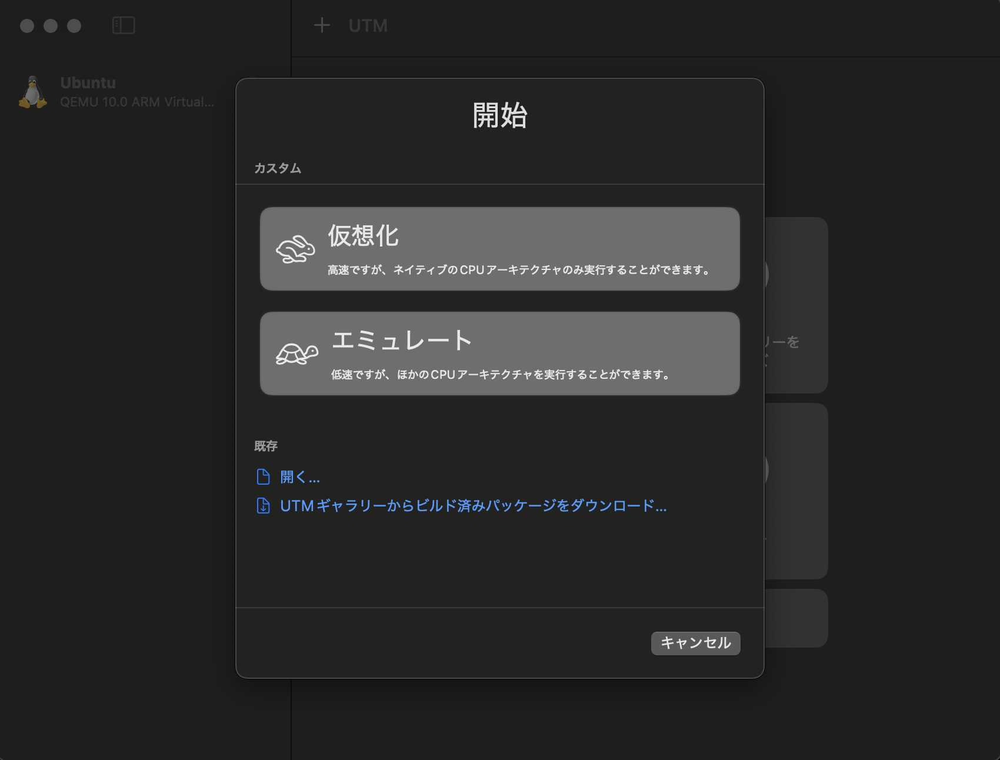
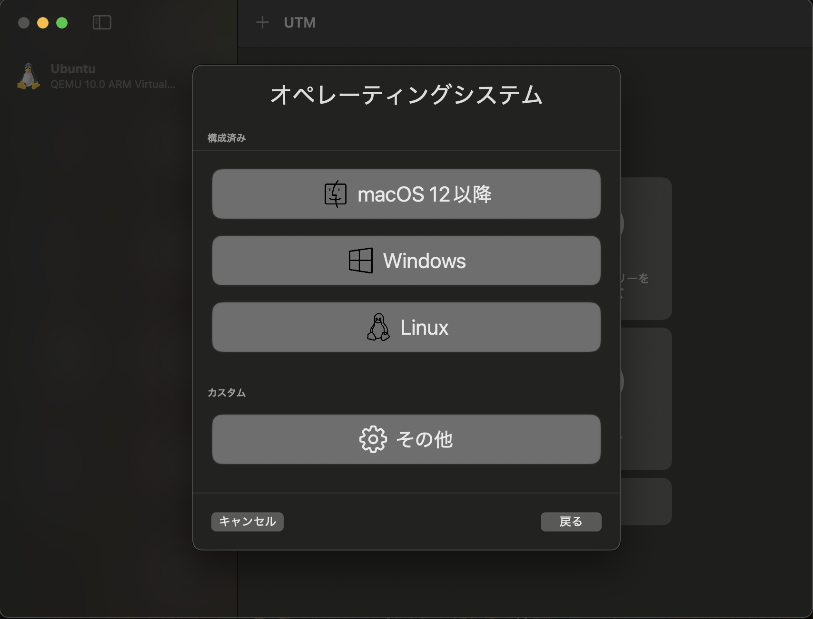
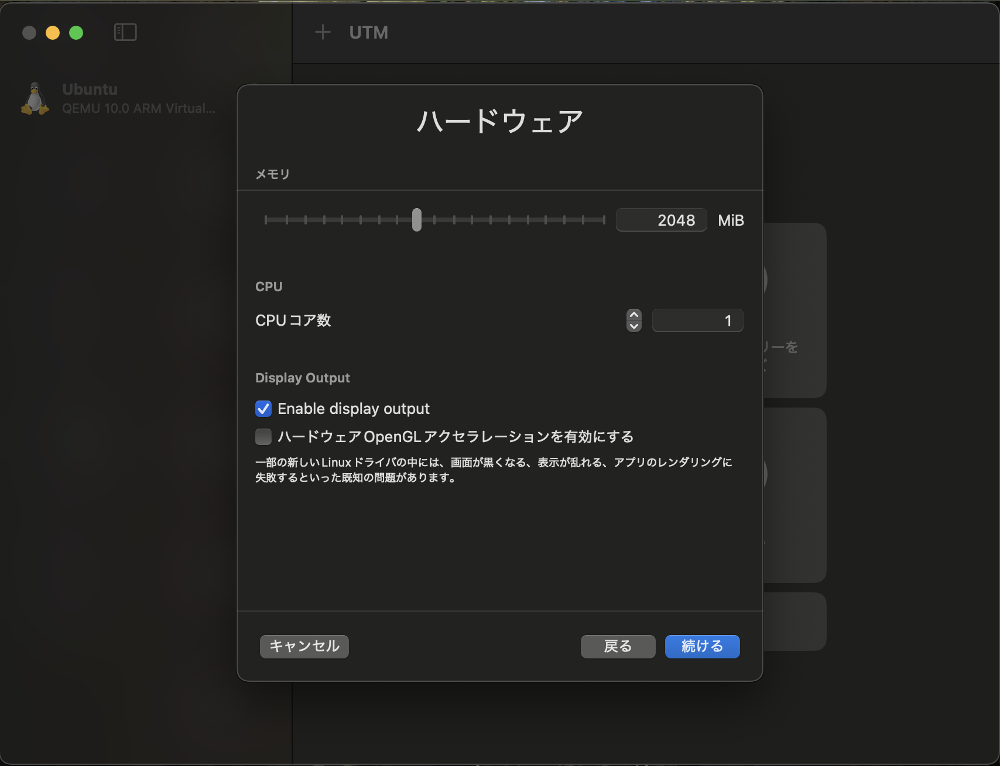
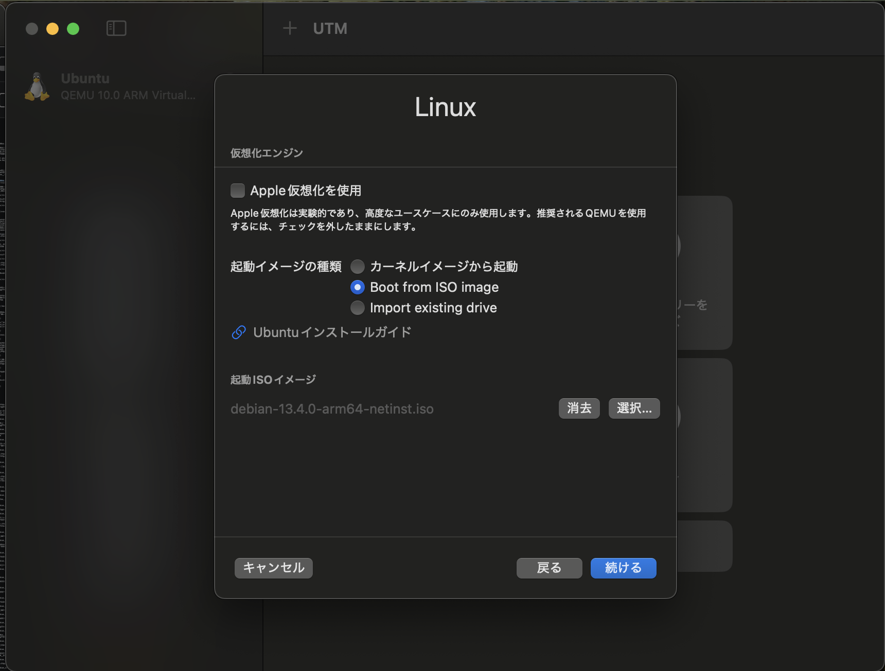
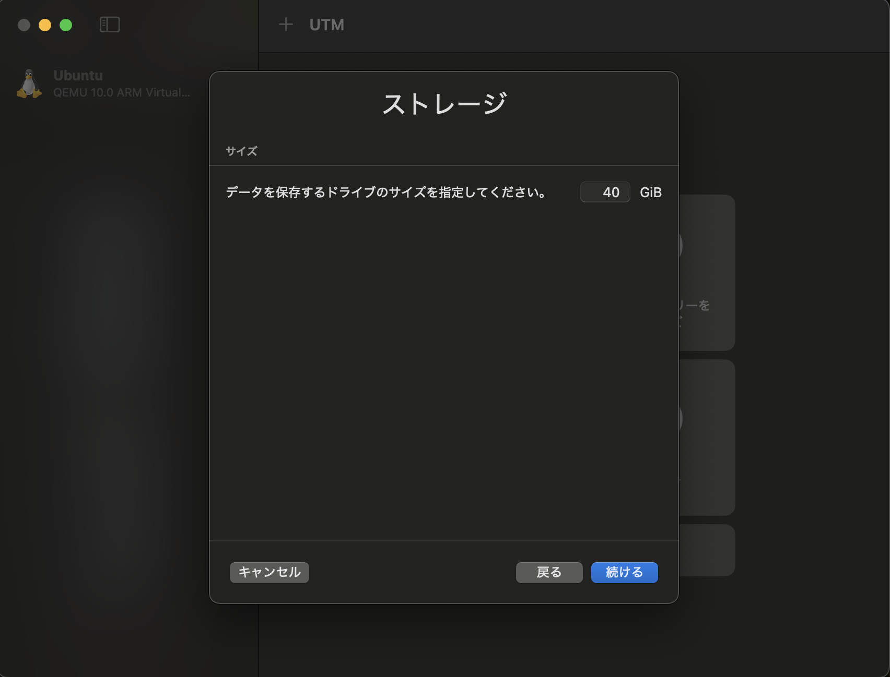
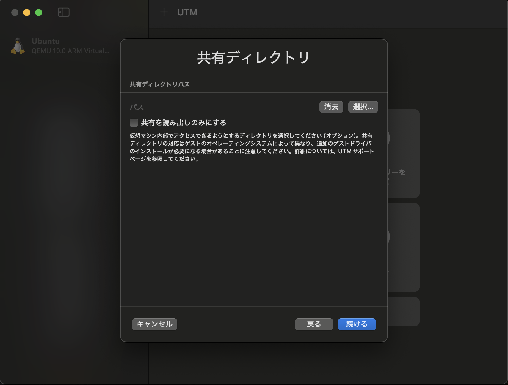
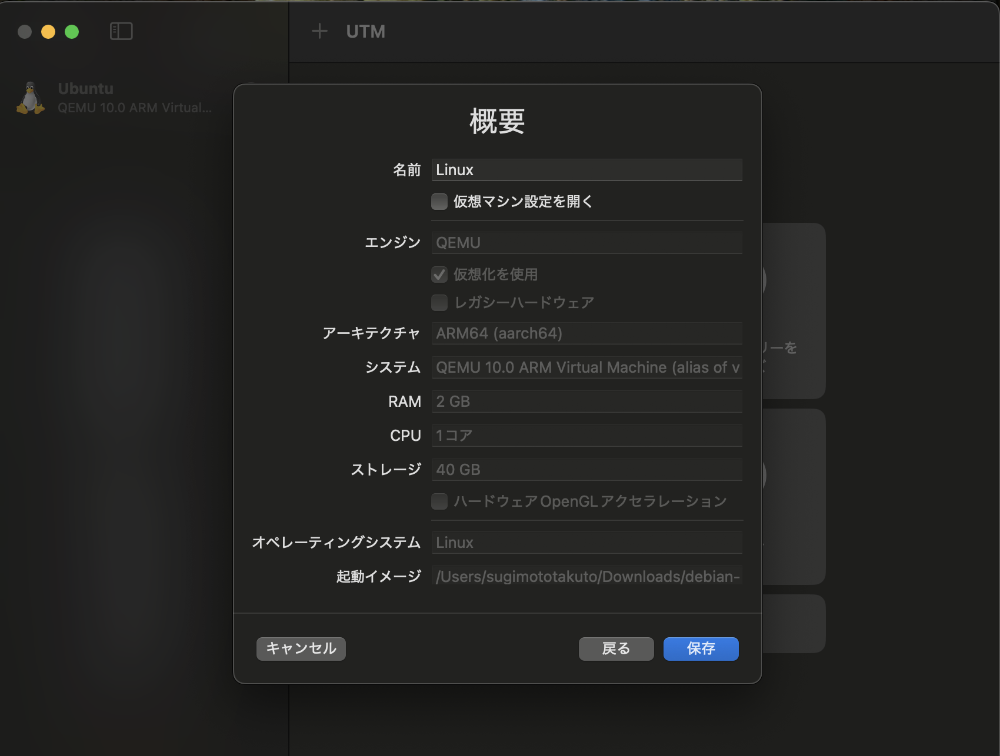
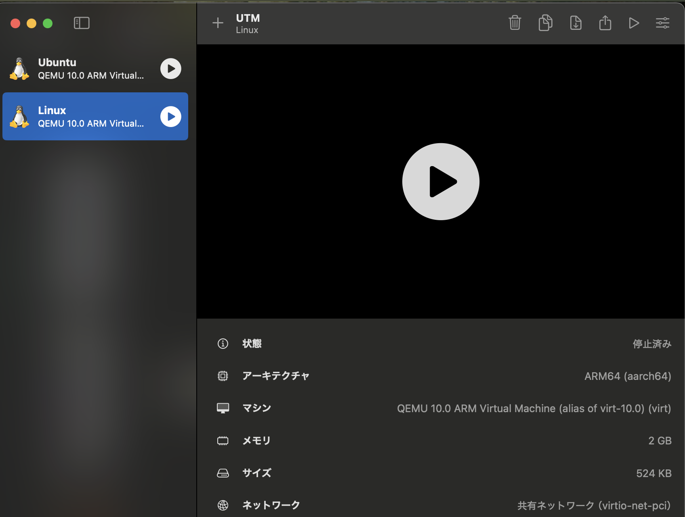

# UTM
## UTMとは
Virtualboxと同じく、ホストOS型の仮想環境を構築するソフトウェアです。macOSで使用できるのが特徴です。

## Debianのインストール
[公式サイト]()Debianをインストールしてきます。netinst CD イメージ (約 150-300 MB ですがアーキテクチャよって変わります)の、arm64のisoイメージをインストールします。

## 使用方法
まずは[公式サイト](https://mac.getutm.app)からUTMをダウンロードしてきてください。

次に、UTMを起動してください。起動すると以下のような画面が表示されます。新規仮想マシンを作成を選択します。

仮想化かエミュレートかの選択肢が表示されます。仮想化はMacのCPUをそのまま使用します。エミュレートはソフトウェアで別のCPUを擬似的に再現します。エミュレートでもいいですが、より高速な仮想化を選択します。

OSを選択します。DebianはLinuxなのでLinuxを選択します。

ハードウェアのメモリ容量とCPUコア数を指定します。課題をするだけなら、メモリは2048Mib, CPUコア数は1で十分です。
*Enable display output*にはチェックを入れておきましょう。チェックを入れないと画面表示が正確にされません。ハードウェアOpenGLアクセラレーションは推奨の通り有効にはしないでおきます。

Apple仮想化は推奨の通り使用しません。起動イメージの種類は*Boot from ISO image*を選択します。起動ISOイメージには、ダウンロードしたarm64のDebianのISOイメージのパスを指定します。

ストレージ容量を指定します。課題では40GiBあれば十分です。

ホストOSとの共有ディレクトリを指定します。何も指定しなくていいです。したければ指定してください。

確認画面です。問題なケラば保存を押してください。間違いがあれば戻るで修正してください。

完成したら、起動してください。再生ボタンを押して起動します。

