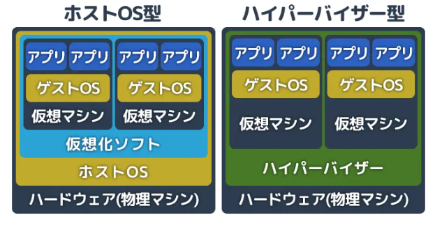

# Linux, VMについて
## サーバーの仮想化
物理的な1台のサーバーで複数の仮想的なサーバーを運用することを、**サーバーの仮想化**といいます。
利用する仮想化ソフトウェアによって、**ホスト型**, **ハイパーバイザー型**の２種類に分類される。ホスト型では、ホストOS上に仮想化ソフトウェアを立ち上げ、そこでゲストOSを運用する、ハイパーバイザー型では、ハイパーバイザーと呼ばれる仮想化ソフトウェアを動作させ、その上でゲストOSを運用します。
このような仮想マシンのことを**Virtual Machine(VM)**といいます。


画像は[引用元](https://www.kagoya.jp/howto/engineer/itsystem/virtualization/)より引用

## Linux
### Linuxカーネルとディストリビューション
**Linux**カーネルとは、OSの心臓部であり、CPU・メモリ・ストレージといったハードウェアを管理する中核プログラムです。
**ディストリビューション**とは、Linuxカーネルにテキストエディタ・パッケージ管理ツール・シェル・ログイン画面などを組み合わせて、実際に使えるOSとして完成させたものです。

### Debian系とRed Hat系
Linuxディストリビューションには大きく分けて2つの系統があります。**Debian系**と**Red Hat系**です。以下のような違いがあります。

| 系統 | 代表例 | パッケージ管理 | 主な用途 |
|---|---|---|---|
| Debian系 | Ubuntu, Debian | apt(apt-get) | デスクトップ・開発・クラウド |
| Red Hat系 | AlmaLinux, Rocky Linux, RHEL | dng(yum) | 企業向けサーバー・本番環境 |

パッケージ管理ツールが違うだけで、基本操作はどのディストリビューションもほとんど同じです。

### MACとDAC
Linuxで採用されているファイルパーミッションには、**任意アクセス制御(DAC)**と、**強制アクセス制御(MAC)**があります。DACはファイルの所有者がアクセス権限を自由に変更できるものです。MACはシステム全体で一元的にセキュリティポリシーを管理し、ユーザーやそのプロセスがそのポリシーに違反する操作を強制的に制限します。MACの代表的な仕組みには、**SELinux**と、**AppArmor**があります。

### SELinuxとAppArmor
#### SElinux
Red Hat系のLinuxディストリビューションで採用されています。NSA(アメリカ国家安全保障局)などが開発した、とにかく厳格なシステム。
全てのファイル、プロセス、ポートにコンテキストという見えないラベルを付与して、そのラベルの組み合わせによってアクセスを許可するかどうかを判定する。
システム全体を徹底的に守れる代わりに、設定が複雑で難しい。

#### AppArmor
Debian系のLinuxディトリビューションで採用されています。
プログラムごとに、このパスにだけアクセスして良いという許可リストをテキストベースで書いて制御する。
ファイルシステム上のパスをそのまま使うため、人間が理解しやすくて簡単なことが特徴。

```bash
sudo aa-status
```

で状況が確認可能です。

### aptとaptitude
#### apt
**apt**は、Debian系のディストリビューションで標準的に使われるパッケージ管理ツールです。
シンプルで直感的、デフォルトでインストールされている、表示がわかりやすいなどのメリットがあります。
一方で、依存関係の処理が苦手だというデメリットもあります。
よく使うコマンドは以下です。
```bash
sudo apt update             # パッケージ情報の更新
sudo apt install [target]   # targetのインストール
sudo apt upgrade            # インストール済みパッケージの更新
```

#### aptitude
**aptitude**は、基本的にはaptと同じですが、複雑な依存関係の衝突を自動的に検知し、複数の解決策を提示してくれます。これにより、安全にパッケージのアップグレードなどを行えます。
インストールは以下のようにaptでインストールします。
```bash
sudo apt install aptitude
```

### UFWとfirewalld
#### UFW
**UFW**は、Debian系のディストリビューションで採用されている、シンプルなファイアウォール管理ツールです。コマンドが直感的で分かりやすいため、初心者にも扱いやすいのが特徴です。

#### firewalld
**firewalld**は、Red Hat系のディストリンビューションで採用されている、ゾーンベースのファイヤウォール管理ツールです。堅牢な代わりに、複雑で初心者向きではないのが特徴です。