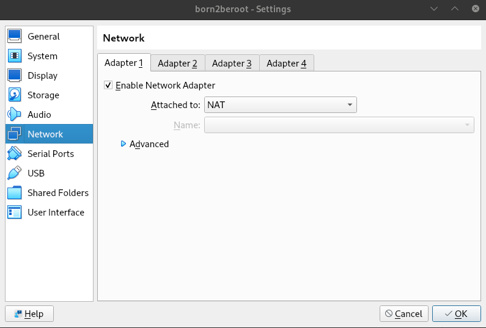
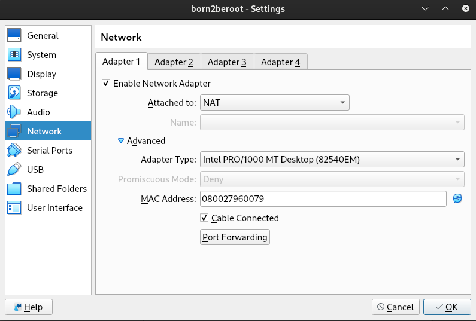
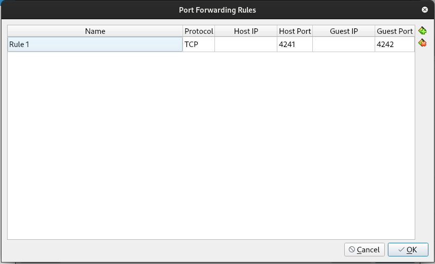
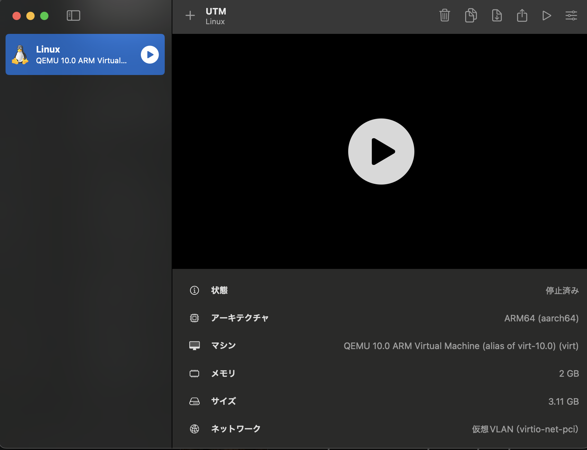
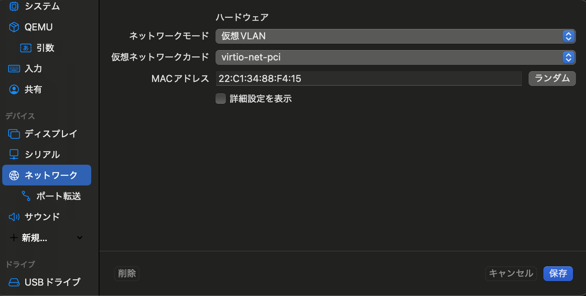
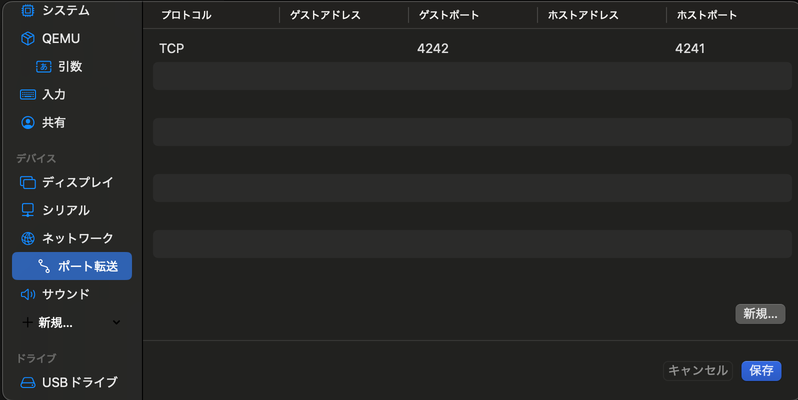

# SSH
## SSH
**SSH**とは、*Secure Shell*の略で、ネットワークを経由して別のコンピュータを操作する際に使用するプロトコルのことです。

## OpenSSH
SSHプロトコルを行うためのオープンソースソフトウェアのこと。以下のコマンドでインストールします。

```bash
sudo apt install openssh-server
```

sshのステータスは以下のコマンドで確認できます。

```bash
sudo  systemctl status ssh
```

`enabled`の表示が出ていれば「今」SSHサーバーが起動しています。
`active(running)`の表示が出ていれば、「OS起動時」にサービスを自動で立ち上げます。

それぞれ以下のコマンドでenabled/disabled, active/inactiveを切り替えれます。

```bash
sudo systemctl start ssh
sudo systemctl stop ssh
sudo systemctl restart ssh # activeのまま再起動
sudo systemctl enable ssh
sudo systemctl disable ssh
```

## ufw
**ufw**は、Debian系Linuxで標準的に使用されるファイアウォール管理ツールです。

```bash
sudo apt install ufw
```

でインストールします。

```bash
sudo ufw status
```

でステータスを確認します。
基本的な設定例は以下のとおりです。

```bash
# 外部からの接続をすべて拒否
sudo ufw default deny incoming
# 内部からの通信はすべて許可
sudo ufw default allow outgoing
# 特定のポートの通信を許可
sudo ufw allow [ポート]
# 特定のポートからの通信を拒否
sudo ufw deny [ポート]
# 許可ルールを削除
sudo ufw delete allow [ポート]
# 拒否ルールを削除
sudo ufw delete deny [ポート]
# 特定のIPからの許可
sudo ufw allow from [IPアドレス] to any port [ポート] proto tcp
# 状態確認
sudo ufw status verbose
```
`sudo ufw allow 4242`で、4242のポートの見通し用にしてください。

## /etc/ssh/sshd_config
`/etc/ssh/sshd_config`は、ssh関連の設定を刷るファイルです。なんでもいいですが、nanoで編集するなら以下のようにします。

```bash
sudo nano /etc/ssh/sshd_config
```

**# Port 22**の部分のコメントを外し、**Port 4242**にすることにより、4242のポートの接続を許可します。SSH接続を最低限するにはここの設定のみで大丈夫です。 
```bash
Port 4242
```

rootユーザでのログインを禁止します。以下の項目を指定します。

```bash
PermitRootLogin no
```

設定をしたければ他にも色々設定できます。

以下のコマンドでsshd_configの設定を反映させます。

```bash
sudo systemctl restart sshd
```

### systemctl(おまけ)
debianでは、初期システムであるsystemdを操作するために、systemctlコマンドを使用します。基本的なコマンドは以下です。
```bash
sudo systemctl start [サービス名]
sudo systemctl stop [サービス名]
sudo systemctl restart [サービス名]
sudo systemctl status [サービス名]
# Linuxの起動時に指定したサービスを自動的に起動するためのコマンド
sudo systemctl enable [サービス名]
sudo systemctl disable [サービス名]
sudo systemctl status [サービス名]
```

## ~/.ssh/config
ホストOSの~/.ssh/configにいらない情報が含まれていると、接続の際にエラーが出てくることがあります。この場合はエラーの該当箇所を修正するか、
```bash
rm -rf ~/.ssh/config
```
でファイルごと削除してしまいましょう。

## VirtualBoxの設定
VirtualBox, UTMのいずれか自分が使用した方で設定をする必要があります。

一度debianの電源を落として、VirtualBoxホーム画面でSettingを開いてください。SettingでNetworkを選択してください。すると、以下のような画面が表示されます。



Advancedを押してください。以下のような画面になるので、Port Forwardingを押してください。



最後に、右上のプラスマークを押して、新規のルールを追加します。Guest Portは課題の要件通り4242にしてください。Host Portは何でも構いません。



## UTMの設定
VirtualBox, UTMのいずれか自分が使用した方で設定をする必要があります。

まずは右上の設定マークを押して設定画面を開きます。



ネットワークの選択画面で、ネットワークモードを仮想VLANに変更します。



すると、ポート転送の設定ができるようになります。ここで、ゲストポートには課題の指示通り4242を指定します。ホストポートは何でも構いません。



## ホストOSからのSSH接続
openSSHの設定、ufwの設定、/etc/ssh/sshd_configの設定、VirtualBoxの設定がすべて完了すると、ホストOSのターミナルからSSH接続でDebianを操作できるようになります。Debianを起動している状態で、ホストOSで以下のコマンドを実行してください

```bash
ssh [ゲストOSのユーザ名]@[ゲストOSのIPアドレス] -p [ホストポート]

ssh [ゲストOSのユーザ名]@localhost -p [ホストポート]
```

ipアドレスは以下のコマンドで確認できます。
```bash
ip a
```