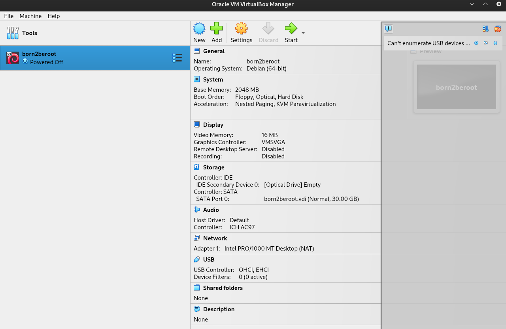
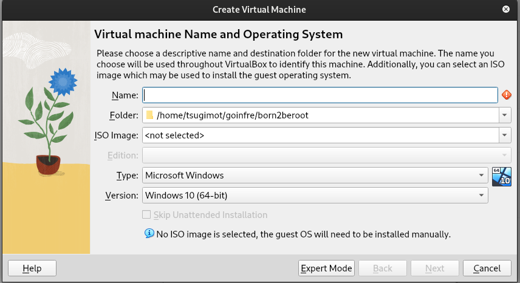
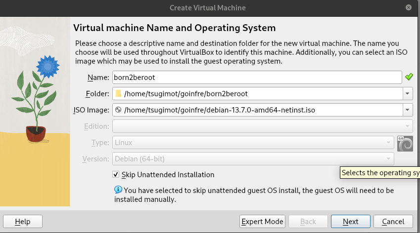
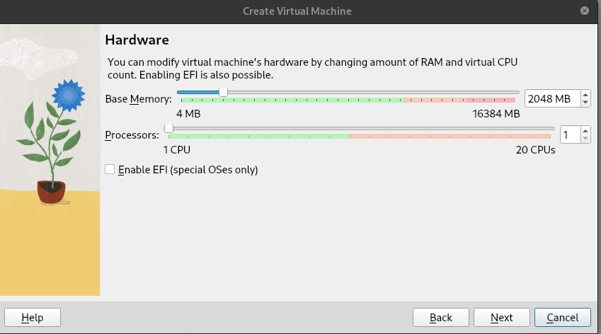
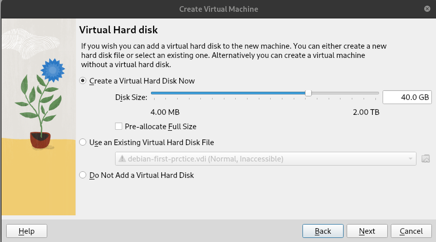
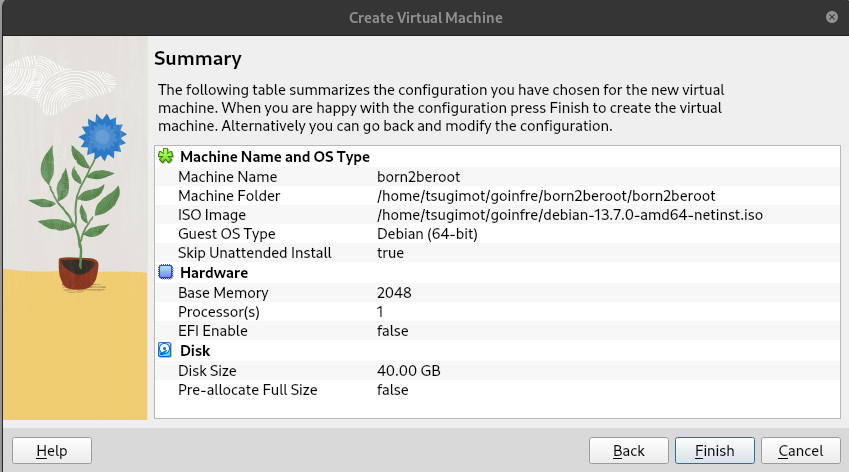
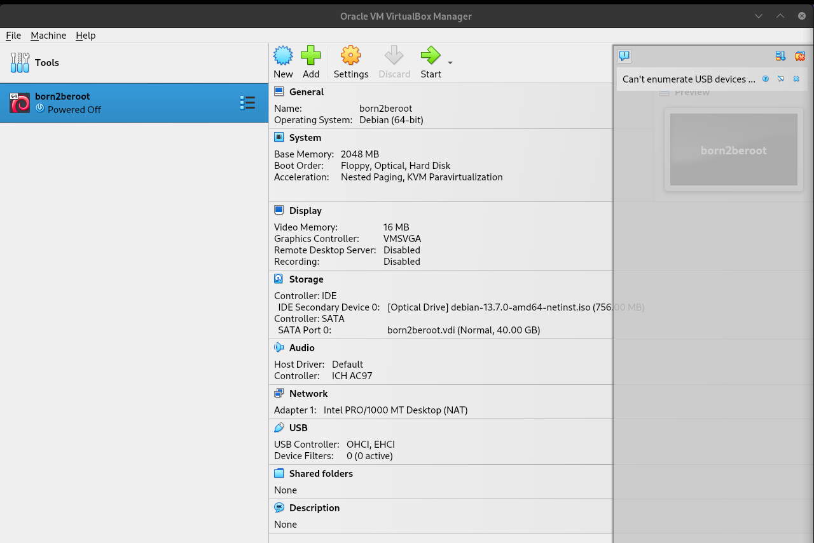

# VirtualBox
## VirtualBoxとは
**VirtualBox**とは、既存のOS上で別yのOSを実行するのに使う仮想環境を構築するためのオープンソフトウェアです。ホストOS型で使用される仮想化ソフトウェアの１つです。macOSでは使用できません。
## ダウンロード
まずはVirtualBoxを[公式サイト](https://www.virtualbox.org/?_fsi=smWrwEF7)からダウンロードしてきます。
## 起動
ダウンロードをしたら、起動します。以下はUbuntuでVirtualBoxを使用したときの動作になりますが、他のOSでもほとんど同じでしょう。
以下の写真のようにホーム画面が起動できれば、Newを押してください。

すると、以下のようなウィンドウが立ち上がります。ここに必要情報を入れていくことにより、仮想環境を構築できます。

## Debianのダウンロード
[公式サイト](debian.org)より、Debianのisoイメージをダウンロードしてきます。
## 設定
VirtualBoxの指示に従って、必要情報を書き込んでいきます。
Nameには仮想環境の名前を、Folderには仮想環境を構築するフォルダーを、ISO Imageには使用するOSのisoイメージを入力してください。42のPCを使用している場合は、Folderはgoinfreあるいはsgoinfreを指定するようにしてください。homeに保存すると容量が足りなくなるためです。isoイメージには、先程ダウンロードしてきたDebianのiosイメージのパスを入力します。

*Skip Unattended Installation*にはチェックを入れておきましょう。オートインストールをしてしまうと、 GUIつきのDebianになってしまいます。

次に、RAMとCPUの割り当てを行います。RAMのメモリは今回は2048MBあれば十分です。CPUも１で構いません。

次に、ハードディスクの割り当てを行います。40GBあれば十分です。

最後に確認画面が表示されます。不備があればBackで設定し直しましょう。大丈夫な場合はFinishで完了します。

設定したdebianがホーム画面の左側に表示されます。選択してStartを押して起動します。

